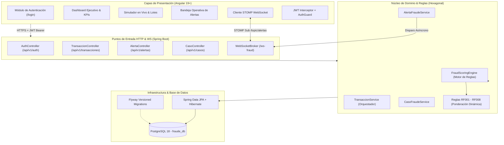

# 🛡️ Security Flow Bank: Sistema Integral de Prevención y Detección de Fraude Bancario en Tiempo Real

> **Documento Guía para Exposición Técnica y Ejecutiva**  
> **Proyecto:** Sistema de Prevención, Scoring y Detección de Fraude Financiero - Security Flow  
> **Tecnologías:** Spring Boot 3.5 (Java 17) • Angular 19+ • PostgreSQL 18 • WebSockets STOMP • Arquitectura Hexagonal  
> **Autor / Equipo:** Equipo de Ingeniería y Ciberseguridad Bancaria  

---

## 📑 Tabla de Contenidos
1. [Resumen Ejecutivo y Propósito del Proyecto](#1-resumen-ejecutivo-y-propósito-del-proyecto)
2. [El Problema de Negocio vs. La Solución Security Flow](#2-el-problema-de-negocio-vs-la-solución-security-flow)
3. [Arquitectura del Sistema (Arquitectura Hexagonal & E2E)](#3-arquitectura-del-sistema-arquitectura-hexagonal--e2e)
4. [Motor de Reglas Antifraude y Algoritmo de Scoring](#4-motor-de-reglas-antifraude-y-algoritmo-de-scoring)
5. [Bondades y Ventajas Competitivas del Sistema](#5-bondades-y-ventajas-competitivas-del-sistema)
6. [Módulos Principales de la Solución](#6-módulos-principales-de-la-solución)
7. [Seguridad, Auditoría y Cumplimiento Normativo](#7-seguridad-auditoría-y-cumplimiento-normativo)
8. [Stack Tecnológico Integral](#8-stack-tecnológico-integral)
9. [Guión de Demostración en Vivo (Demo Pitch)](#9-guión-de-demostración-en-vivo-demo-pitch)

---

## 1. Resumen Ejecutivo y Propósito del Proyecto

**Security Flow Bank** cuenta con una plataforma tecnológica de grado bancario diseñada para evaluar, calificar y contener transacciones sospechosas en **milisegundos**. Combina un **motor de reglas determinísticas ponderadas**, **notificaciones push reactivas mediante WebSockets**, un **simulador de estrés de tráfico financiero** y un **centro de mando operativo** para analistas de ciberfraude.

El sistema garantiza que cada movimiento monetario (Transferencias Web, App Móvil, POS o Cajeros) sea analizado contra patrones históricos de comportamiento del cliente, geolocalización, dispositivos no reconocidos y anomalías transaccionales antes de liquidar el saldo.

---

## 2. El Problema de Negocio vs. La Solución Security Flow

```
           DESAFÍO TRADICIONAL                                  SOLUCIÓN SECURITY FLOW
┌────────────────────────────────────────┐            ┌────────────────────────────────────────┐
│ • Detección en batch (horas después)   │            │ • Scoring sub-segundo (< 80 ms)        │
│ • Bloqueos manuales y tardíos          │   ────►    │ • Retención y bloqueo preventivo auto  │
│ • Fricción alta con clientes legítimos │            │ • Calibración de umbrales en caliente  │
│ • Carencia de trazabilidad auditora    │            │ • Correlation-ID y log inmutable       │
└────────────────────────────────────────┘            └────────────────────────────────────────┘
```

| Desafío en la Banca Moderna | Impacto Negativo | Cómo lo Resuelve Security Flow |
|---|---|---|
| **Ataques en Horario Inusual** | Pérdidas millonarias mientras el cliente duerme. | Detección automática de transacciones nocturnas (00:00 - 05:00) combinada con montos atípicos. |
| **Robo de Identidad / SIM Swapping** | Operaciones autorizadas desde IPs o dispositivos nuevos. | Validación de huella digital de dispositivo (`fingerprint`) y cambio brusco de IP/País. |
| **Retraso Operativo del Analista** | El analista se entera cuando la víctima reclama. | Notificación instantánea sin refrescar página vía **WebSockets STOMP**. |
| **Falsos Positivos** | Cuentas legítimas bloqueadas injustamente. | Sistema de Scoring multicapa (0 - 100 pts) con 4 estados de decisión graduados. |

---

## 3. Arquitectura del Sistema (Arquitectura Hexagonal & E2E)

El backend implementa **Arquitectura Hexagonal (Ports & Adapters)** regida por los principios de **Clean Architecture** y **Domain-Driven Design (DDD)**. La lógica central del negocio está completamente desacoplada de la base de datos, del framework web y de los protocolos de mensajería.

### Diagrama Arquitectónico Integral



### Principios Arquitectónicos Destacados:
1. **Inversión de Dependencias (DIP):** Los servicios de negocio definen interfaces (*Ports*) implementadas por adaptadores de persistencia y notificación.
2. **Aislamiento de Seguridad:** Filtros JWT de alta velocidad en cadena de Spring Security con políticas CORS granulares (`http://localhost:*`).
3. **Escalabilidad y Concurrencia:** Sesiones *Stateless* con token Bearer que permiten replicar el microservicio horizontalmente detrás de un balanceador de carga.

---

## 4. Motor de Reglas Antifraude y Algoritmo de Scoring

El motor evalúa concurrentemente un catálogo de reglas preconfiguradas. Cada regla calcula una evidencia observable y aporta un puntaje proporcional al riesgo:

| Código | Regla de Negocio | Condición de Activación | Puntos |
|---|---|---|:---:|
| **RF001** | **Monto Elevado Atípico** | La transacción supera el percentil histórico normal del cliente. | **+30** |
| **RF002** | **Horario Nocturno Inusual** | Operación efectuada entre las 00:00 y las 05:00 hrs. | **+20** |
| **RF003** | **Dispositivo No Habitual** | Huella de hardware (`device fingerprint`) nunca antes vista para la cuenta. | **+25** |
| **RF004** | **Ubicación Geográfica Sospechosa** | Operación desde país de alto riesgo (Rusia, Nigeria, etc.) o inconsistente. | **+35** |
| **RF005** | **Alta Frecuencia Transaccional** | Ráfaga de transferencias múltiples en ventana menor a 5 minutos. | **+25** |
| **RF006** | **Canal Inusual** | Canal no habitual para el tipo de cliente. | **+15** |
| **RF007** | **Saldo Casi en Cero** | La transferencia vacía más del 95% de los fondos disponibles. | **+20** |
| **RF008** | **Paraíso Fiscal / Lista Gris** | Destino vinculado a jurisdicciones sancionadas. | **+40** |

### Matriz de Decisión Automatizada:

$$\text{Score Total} = \min\left(100, \sum \text{Puntos de Reglas Disparadas}\right)$$

```
  0 pts                35 pts                 70 pts                 85 pts          100 pts
  ┌──────────────────────┬──────────────────────┬──────────────────────┬────────────────┐
  │     RIESGO BAJO      │     RIESGO MEDIO     │     RIESGO ALTO      │ RIESGO CRÍTICO │
  │    (0 - 34 pts)      │    (35 - 69 pts)     │    (70 - 84 pts)     │ (85 - 100 pts) │
  └──────────────────────┴──────────────────────┴──────────────────────┴────────────────┘
         APROBAR               MONITOREAR               RETENER               BLOQUEAR
    (Pasa sin trabas)     (Marcado preventivo)   (Requiere validación)   (Rechazo inmediato)
```

---

## 5. Bondades y Ventajas Competitivas del Sistema

### ⚡ 1. Notificaciones en Tiempo Real Absoluto (Zero-Polling)
- En lugar de saturar la red consultando cada segundo mediante HTTP polling, Security Flow utiliza **WebSockets sobre protocolo STOMP 1.2**.
- Cuando el motor clasifica una transacción como `ALTA` o `CRÍTICA`, emite inmediatamente un evento al tópico `/topic/alertas`. El analista ve aparecer la tarjeta de alerta en su pantalla con un pulso visual luminiscente en menos de **50 milisegundos**.

### 🧪 2. Simulador de Estrés Financiero (Lab de Ciberdefensa)
- **Simulación Individual:** Permite al operador probar hipótesis inyectando montos, países extranjeros (Rusia, EE.UU.), proxies Tor o nuevos dispositivos.
- **Simulación por Lotes Masivos:** Capacidad de generar tráfico bancario sintético con 3 perfiles de estrés:
  1. *Tráfico Mixto Realista:* 75% compras cotidianas, 25% anomalías.
  2. *Ataque Crítico / Phishing:* Ráfagas de fraude severo que disparan las defensas del sistema.
  3. *Operación Estándar Segura:* Tráfico pacífico para validar ausencia de falsos positivos.
- **Calibración Dinámica de Umbral:** Slider reactivo (1 - 100) que reclasifica en caliente las transacciones existentes.

### 📊 3. Centro de Mando Operativo y Auditoría Legal
- **Acciones Rápidas:** Aprobación, Retención Preventiva y Bloqueo definitivo con actualización en base de datos.
- **Expedientes de Investigación Formal:** Escalado de alertas a casos de auditoría con bitácora cronológica inmutable (`historial_caso`), fundamental ante reclamos regulatorios (SBS / Banco Central).
- **Exportación Financiera:** Descarga directa de reportes a **Microsoft Excel (.xls con formato bancario estilizado)** y **CSV**.

### 🔐 4. Conexión 100% Auténtica (Cero Mocks)
- Todos los datos provienen de entidades relacionales en **PostgreSQL 18**: cuentas auditables (`CTA-001-445522`), clientes reales, saldos y catálogo oficial de canales bancarios (`APP`, `WEB`, `ATM`, `POS`).

---

## 6. Módulos Principales de la Solución

```
                               PORTAL SECURITY FLOW BANK
                                            │
         ┌───────────────────┬──────────────┴───────┬───────────────────┐
         ▼                   ▼                      ▼                   ▼
   ┌───────────┐       ┌───────────┐          ┌───────────┐       ┌───────────┐
   │ Dashboard │       │  Bandeja  │          │ Simulador │       │ Centro de │
   │ Ejecutivo │       │  Alertas  │          │  en Vivo  │       │   Casos   │
   └───────────┘       └───────────┘          └───────────┘       └───────────┘
   • KPIs Riesgo       • Filtros Urgencia     • Tráfico Lotes     • Expedientes
   • Distribución      • Detalle Reglas       • Streaming Auto    • Dictamen
   • Gráficos Torta    • Acciones 1-Click     • Calibrador Score  • Auditoría
```

1. **Módulo de Login Seguro:** Autenticación JWT con credenciales demo preconfiguradas para roles de *Analista de Fraude* y *Administrador*.
2. **Dashboard de Monitoreo:** Métricas de transacciones supervisadas, porcentaje de corte, score promedio y panel de detalle expandible.
3. **Bandeja de Gestión de Alertas:** Clasificación por severidad (`CRÍTICA`, `ALTA`, `MEDIA`, `BAJA`) con visualización de evidencias de reglas disparadas.
4. **Laboratorio de Simulación:** Panel interactivo para inyectar transacciones en vivo hacia los endpoints de Spring Boot.

---

## 7. Seguridad, Auditoría y Cumplimiento Normativo

- **Autenticación Basada en Tokens (JWT):** Claves HMAC-SHA256 con tiempo de expiración programable.
- **Control de Acceso Basado en Roles (RBAC):** Restricción de endpoints según los privilegios:
  - `ROLE_ANALISTA_FRAUDE`: Gestión de alertas, escalado y visualización.
  - `ROLE_ADMIN`: Acceso a parámetros del sistema y simulador.
- **Trazabilidad de Extremo a Extremo:** Cabecera `X-Correlation-Id` generada en cada petición para cruce de logs entre microservicios.
- **Integridad de Base de Datos:** Migraciones versionadas con **Flyway** (`V1` a `V5`), asegurando consistencia de esquemas, llaves foráneas y secuencias seriales.

---

## 8. Stack Tecnológico Integral

| Capa | Tecnología | Propósito |
|---|---|---|
| **Backend Runtime** | Java 17 LTS | Rendimiento empresarial y tipado robusto |
| **Framework Base** | Spring Boot 3.5 | Inversión de control y ecosistema de microservicios |
| **Seguridad** | Spring Security 6 + JJWT | Autenticación stateless, filtros JWT y CORS |
| **Datos & ORM** | Spring Data JPA / Hibernate | Persistencia ORM y transaccionalidad ACID |
| **Migraciones DB** | Flyway Database Migrations | Versionamiento del esquema SQL y datos semilla |
| **Base de Datos** | PostgreSQL 18 | Motor relacional transaccional bancario |
| **Streaming / Realtime** | Spring WebSocket + STOMP 1.2 | Notificación bidireccional reactiva |
| **Frontend Framework** | Angular 19+ (Standalone) | SPA reactiva con signals y observables RxJS |
| **Estilos & Diseño** | Bootstrap 5 + SCSS Custom | Estética bancaria moderna con modo oscuro |
| **Documentación API** | OpenAPI 3 / Swagger UI | Especificación interactiva de contratos REST |
| **Grafo de Conocimiento** | Graphify Knowledge Graph | Mapeo topológico de dependencias de la solución |

---

## 9. Guión de Demostración en Vivo (Demo Pitch)

Para una presentación exitosa ante evaluadores o jurado, sigue este flujo de 5 minutos:

### Paso 1: Introducción y Login Seguro (1 min)
- Muestra la pantalla de `/login` con diseño de ciberseguridad bancaria.
- Haz clic en el botón de acceso rápido **"🛡️ Analista de Fraude"** (`analista_seguridad`) e inicia sesión.
- Explica que el token JWT es recibido, validado por `jwtInterceptor` y almacenado de forma segura.

### Paso 2: Dashboard y Telemetría en Vivo (1 min)
- Muestra los KPIs: *Total de Alertas*, *Alertas Críticas*, *Score Promedio* y *Transacciones Monitoreadas*.
- Destaca cómo todos los datos provienen en vivo desde PostgreSQL.

### Paso 3: Disparo de Alerta en Tiempo Real con WebSockets (1.5 min)
- Abre la pestaña de **Simulador de Fraude**.
- Ejecuta una **Simulación Individual** ingresando un monto elevado (`S/ 14,850.00`), país `Rusia` y dispositivo `Tor Browser / Proxy Anónimo`.
- Presiona **"Ejecutar Simulación con Motor IA"**.
- Muestra el resultado: El motor de Spring Boot dispara las reglas `RF001` (Monto atípico), `RF003` (Dispositivo nuevo) y `RF004` (País de alto riesgo), arrojando un Score de ~90 pts (`CRÍTICO`).
- Enseña la notificación en tiempo real llegada a través de WebSocket sin recargar el navegador.

### Paso 4: Pruebas de Carga y Simulación por Lotes (1 min)
- Presiona el botón de lote **"💥 Ataque Masivo / Phishing (25 TXs)"**.
- Observa cómo el backend procesa las transacciones concurrentemente y las almacena en PostgreSQL.
- Mueve el **Slider del Umbral de Riesgo** (por ejemplo de 70 a 50 pts) para demostrar cómo el sistema recalibra el corte de tolerancia al fraude en tiempo real.

### Paso 5: Gestión Operativa y Auditoría (0.5 min)
- Ve a la **Bandeja de Alertas**, expande la alerta recién generada y presiona **"Bloquear Transacción"**.
- Descarga el reporte haciendo clic en **"Exportar a Excel"** para evidenciar el archivo bancario generado con formato profesional.
- Cierra la exposición enfatizando que Security Flow previene el fraude **antes de que los fondos salgan del banco**.

---

> 💡 *Tip para la Exposición:* Ten abiertas dos pestañas del navegador (una en el Dashboard y otra en el Simulador) para que la audiencia vea cómo la alerta aparece instantáneamente en el Dashboard al dispararse la simulación.
